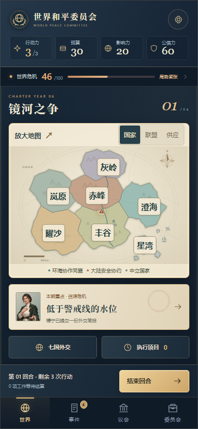
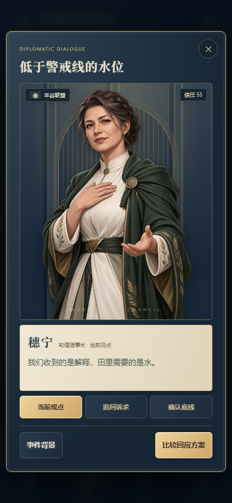

# 世界和平委员会

一款为手机竖屏设计的回合制外交策略游戏。你主持一个架空世界的和平委员会，在七个国家之间调查事实、协调资源、提出议案，并面对选择引发的连锁后果。

**胜利目标是在 24 回合内把世界危机值降至 0。**

本仓库恢复改名前的七国故事，以原版 0.6.0 游戏资源为基础。人物、国家、联盟及其历史均为虚构。





## 开始试玩

需要 Node.js 22 或更高版本。本项目使用浏览器原生模块和 Node.js 内置工具。

```sh
git clone https://github.com/chenyion/world-peace-committee.git
cd world-peace-committee
npm start
```

打开 http://127.0.0.1:4187/ ，从主菜单选择“开始游戏”。

生成可直接双击打开、内嵌全部立绘的离线页面。

```sh
npm run build
```

随后打开根目录的 `世界和平委员会.html`。单文件版和本地服务版使用各自浏览器来源的存档，可通过导出、导入 JSON 转移进度。

## 你可以做什么

- 在七国地图上查看国家诉求、资源、联盟与领导人立场。
- 每回合使用 3 点行动力，调查事件、外交谈判、援助民生或提出议案。
- 通过第三国的利益与资源，改变当前冲突的协商条件。
- 听取领导人的发言、诉求和底线，再选择回应。
- 提交普通议案或重大议案，分别争取至少 4 票和 5 票。
- 跟进跨回合工程、承诺、停火及后续事件。获得授权后仍需要落实。
- 调整字号、音量、按键反馈，使用自动存档及三个手动存档位。

当前包含 16 个核心事件和 12 个随机及后续事件模板，每个事件提供四个决策入口。随机来函有独立随机流、期限和后续队列。存档保存随机状态，阅读和重载不会重新抽签。

## 七国与领导人

| 国家 | 领导人 | 主要资源与立场 |
| --- | --- | --- |
| 岚原共和国 | 林序 | 工业与工程，重视能源和粮食进口 |
| 赤峰联邦 | 赫连铎 | 陆路与军事，要求对等安全保证 |
| 澄海共同体 | 闻澜 | 港口与航运，重视通航和贸易 |
| 丰谷联盟 | 穗宁 | 粮食与农业，关注灌溉与民生 |
| 灰岭公国 | 塞芙琳 | 水源与矿产，要求维护自主权 |
| 曜沙王国 | 萨弥尔 | 能源与资金，希望换取粮食与设备 |
| 星湾共和国 | 叶衡 | 金融与规则，重视核验与履约 |

## 开发与验证

```sh
npm test
npm run build
```

浏览器集成检查使用 Chrome。默认读取 Windows Chrome 路径，其他系统可设置 `CHROME_PATH` 后运行 `npm run test:browser`。检查会启动独立临时浏览器目录，覆盖多种竖屏尺寸、人物发言、事件分支、设置、存档和胜利路线。

本次恢复通过 45 项规则测试及四种竖屏尺寸的 737 项布局检查，包含完整胜利路线、七位领导人发言与存档恢复。安卓桥接检查使用浏览器模拟，安卓 APK 构建与手机实测尚未完成。

## 项目结构

- `dist/` 包含可运行的网页源码、样式、地图和七张立绘。
- `dist/data.js` 定义国家、主线事件、议案和危机来源。
- `dist/random-events.js` 定义随机事件、概率分支和后续事件。
- `dist/engine.js` 处理行动、投票、项目执行与结局。
- `dist/phone-ui.js` 负责固定竖屏界面和分页弹窗。
- `tests/` 包含游戏规则、随机事件、设置和平台适配的测试。
- `docs/` 包含原始设计路线、世界观、事件系统与事件库。
- `android/` 提供离线安卓容器，支持本机存档、文件导入导出和振动。

详细设定见[世界观与七国设定](docs/02-世界观与七国设定.md)，规划见[游戏设计与开发路线](docs/01-游戏设计与开发路线.md)。设计文档中尚未实现的内容以当前游戏源码和界面为准。

## 安卓版本

使用 Android Studio 打开 `android/`。构建环境为 JDK 11、Gradle 7.2、Android SDK 33 和 Android Gradle Plugin 7.1.3。命令行可运行 `gradle -p android :app:assembleDebug`，调试 APK 使用开发者自己的本机调试签名。

安卓容器直接读取随包游戏资源，进度保存在应用私有空间。导入与导出由系统文件选择器完成。本开源版本提供离线游玩，不集成账号、广告或平台认证 SDK。发布到分发平台时需按对应要求自行集成和配置。

## 项目状态与授权

这是一个可玩的规则验证原型。外交采用信任和明确条件，战争与制裁以战略数值结算。最初设计文档中的全部事件、派系和动态联盟尚未实现。

代码与原创文本采用 [MIT 许可证](LICENSE)。人物立绘由 AI 生成，具体来源和使用说明见[素材说明](ASSETS.md)。欢迎提交问题、修复和新的事件设计。
