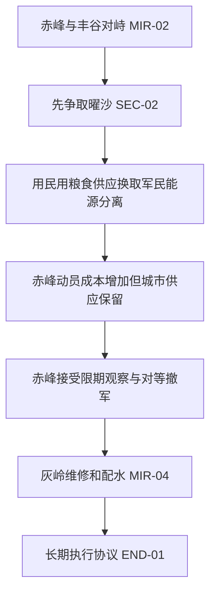

# 世界和平委员会：随机事件系统与制作顺序

版本：v0.2 事件设计草案  
日期：2026-10-27  
范围：固定七国、单机回合制、危机归零获胜  
配套：[事件库](./04-七国随机事件库.md) · [游戏大纲](./01-游戏设计与开发路线.md) · [世界观](./02-世界观与七国设定.md)

> 本轮交付是事件内容与系统设计，尚未编写游戏事件引擎。40 个模板各有 A～D 四个决策入口，共 160 个入口；这不等于 160 条互不相干的完整剧情。分支通过世界状态组合、交叉和汇合。

## 1. 设计目标

随机事件应改变玩家的判断和布局。相同事件在不同世界状态下，可以有不同可选项、成本、他国回应和延迟结果。

需要同时做到：

1. **世界会自己行动**：忽略某国，那个国家仍会处理自己的问题。
2. **选择留下记忆**：答应过的事、公开过的证据、使用过的施压手段都会被记录。
3. **第三国能够改变主线**：处理曜沙、澄海、岚原或星湾，确实会影响赤峰与丰谷。
4. **坏结果可解释**：知道是资源不足、违约、情报错误还是执行风险导致。
5. **和平有建设过程**：局势缓和后仍需执行，但不能无限生成新的阻碍。
6. **允许惊喜**：也有主动合作、技术进步、民间互助和天气转好的机会。

## 2. 什么随机，什么不随机

| 部分 | 规则 |
| --- | --- |
| 国家身份与人物过去 | 固定，不为制造反转临时改写 |
| 镜河教学剧本真相 | 保持既定的旱情、闸门故障和中游取水叠加 |
| 事件是否符合条件 | 确定性检查；条件不满足就不出现 |
| 多个合格事件先出现哪个 | 可按权重随机 |
| 国家愿不愿谈判 | 依据利益、底线、信任与可执行保障 |
| 已确认事实 | 不因玩家选择而重新抽取 |
| 运输、工程等执行结果 | 在已展示的风险范围内抽取 |
| 无人干预时的演化 | 状态驱动，只有合理的不确定环节随机 |
| 正式表决 | 按各国最终立场计票，不额外掷骰翻转结果 |

不把每个好选择都加上失败概率。证据充分、资金到位、各方同意且执行条件满足时，应有可以确定获得的结果。

## 3. 事件的四种来源

- **主线入口**：例如 MIR-01，作为本局初始问题，固定或从剧本池选择。
- **因果后续**：例如援助受阻引出 HUM-02，来自已存在的状态。
- **机会窗口**：例如 PER-02 的工程方案，满足条件才进入抽取池。
- **外生扰动**：例如 ENV-01 风暴，具有独立发生性，但受季节和模式限制。

玩家主动发起议案、长期协议、停火或项目退场时，立即进入相应流程，不等待随机抽到 POL-01 或 END 类事件。

## 4. 状态与危机的对应

事件操作基础状态，由状态计算危机，避免“每点击一次选项就任意加减总危机”。

### 4.1 初版需要的状态

| 类型 | 示例 |
| --- | --- |
| 问题强度，0～3 | 供水短缺、粮食短缺、能源短缺、航运风险、信用风险 |
| 军事状态 | 平静、对峙、最后通牒、交战、停火、解除动员 |
| 关系与资源 | 国家信任、双边关系、预算、影响力、公信力 |
| 事实与证据 | 闸门故障已确认、取水数据已确认、事故归责已确认 |
| 授权与准入 | 灰岭调查准入、观察团准入、制裁授权 |
| 项目 | 维修、救援、监督；各有资金、进度、维护费与退出条件 |
| 承诺 | 提出者、受益者、内容、期限、履行与违约结果 |
| 历史标签 | 公开羞辱、履行保证、保护证人、选择透明招标 |

事件库中“短缺下降一级”等表述指基础状态变化。若同一事件导致两个独立问题，可分别登记，但同一问题的新闻与跟进不能重复计分。

### 4.2 危机来源登记

每个来源保存 `source_id`、关联对象、当前贡献、原因、解除条件。开局四类来源仍合计 46：对峙 16、供水与粮食 12、联盟升级 10、航运与履约 8。

后续精确映射在数值配置表中统一制定。事件文案不直接硬写“总危机 -10”，避免多个系统各自扣同一分。

所有会阻止归零的现实风险都必须在危机面板显示。尚未发生、没有当前风险依据的未来事件不提前计分。

## 5. 每个模板的标准结构

```text
事件 ID / 标题 / 版本 / 优先级
来源类型 / 参与国 / 关联危机来源
触发条件 / 互斥条件 / 冷却与重入条件
公开信息 / 已确定但未知的事实 / 线索
期限 / 自然演化规则
A、B、C、D 决策：
  前置条件
  行动力、预算、影响力及长期承诺
  立即变化
  国家回应条件
  T+1、T+2 或条件满足时的后续
  失败与补救
关闭条件 / 取消后续条件 / 可汇合节点
```

世界状态变化可以关闭事件，即使玩家没有点击该卡片。例如已通过其他渠道修好水库，旧维修事件应更新或归档。

## 6. 事件库的统一阅读约定

- `T+1` 指选择后的下一次回合结算，`T+2` 指再下一次；即时效果在确认行动时发生。
- `窗口 2` 指首次显示后，玩家有当前回合及下一回合共两次行动阶段；第二次结束时执行超时分支。
- 除明确写成“提案”“签订”“启动项目”的流程外，A～C 默认消耗 1 行动力；D 默认不耗行动力。具体额外费用写在选项内。
- 费用写法如“预算 4、影响力 2”表示扣除；未列费用视为 0。长期承诺另列，不能隐性扣款。
- 同一事件实例只能确认一个选项；后续会谈与项目调整通过对应新阶段或通用操作完成，不能重复点击刷收益。
- “提出／争取／要求”只代表发起行动。需对方同意、证据或授权的效果，在条件满足后才生效。
- 被拒绝时，行动力与已投入的外交影响力不退；尚未执行的援助或项目预算只预留，拒绝后释放。调查与紧急运输的实际出勤费用不退。
- 玩家可明确选择等待，也可先做其他事；后者不会提前关闭卡片，到期仍按 D 结算。
- 事件默认每局每个对象只触发一次，持续问题留在项目或危机面板继续处理；不靠反复弹同一卡推进。
- 例外：POL-01、POL-02 按议案 ID 重入；POL-03 按承诺 ID；END-01 按协议 ID；END-02 按战争 ID；END-03 按项目 ID。每个实例仍只结算一次。
- 机会事件到期通常只是错失机会，不自动降低公信力。
- 各卡中的 P0/P1/P2 是制作顺序，不是游戏中的事件严重程度。

## 7. 调度与手机端节奏

每回合结束先处理到期后果，再更新状态并检查胜负，未结束才准备下一回合新事件。

### 7.1 初始建议

1. 每回合新出现的“需要决策”卡片最多 2 张；同时开放的决策卡片目标上限 4 张。
2. 到期承诺、停火执行和必然恶化不会被抽卡预算跳过。它们先进入持续危机面板，并按危险度合并提示。
3. 等待调度的随机卡片不开始计时；已经生效的世界风险继续计时，始终显示在面板。
4. 单局建议实际接触约 14～22 个事件实例，包括主动打开的流程。数量是体验目标，不是强制配额。
5. 有合格机会事件时可留出机会位，不为了配比虚构好消息。
6. 最近 3 回合的新抽取事件尽量不连续集中同一国家，但因果后续不被此软规则禁止。
7. 高危状态优先抽取已有危机的处理与缓和窗口，而不是提高无关灾难出现率。

### 7.2 外生重大危机预算

24 回合标准模式暂定：第 1～8 回合最多新开 2 条独立重大危机，第 9～16 回合最多再开 1 条，第 17 回合起不新开独立重大危机。主线和开局已存在的问题不占此额度，已发生选择产生的后果仍按规则结算。

同一事件若只加重当前来源，不能又以新来源重复计分。普通模式只从“无未解决状态冲突、有可用补救路线”的事件中抽取。

危机归零即结束；不能因队列里还有未触发的随机事件阻止获胜。

## 8. 随机权重与概率示例

先做前置过滤，再计算权重：

> 权重 = 基础权重 × 状态相关度 × 历史相关度 × 新鲜度修正。

任何前置不满足时权重为 0。抽取结果、隐藏事实和执行掷骰保存到存档；相同种子加相同操作顺序应得到相同结果。

### 8.1 运输风险示例

这是原型测试参数，并非现实统计：

```text
延误概率 = 限制在 5%～60% 内的
          10% + 20%×恶劣天气 + 15%×未协调检查
              - 10%×合格护航 - 10%×已确认备用路线
```

每个因素取 0 或 1。玩家执行前能看到已知因素与估计风险；未知因素只给风险范围，不能显示虚假的精确值。延误消耗一次运输尝试，不等于物资全部损失；灾难性损失需要另有明确前兆和机制。

### 8.2 国家同意示例

灰岭是否同意调查，先检查主权底线：无限期托管且没有退出机制，直接拒绝。存在限期安排、本国参与、数据共享且没有严重失信时，提高接受评分。评分达标则同意，不在同意后再掷骰让其反悔。

真实执行失败与政治拒绝分开记录，便于玩家选择修复运输条件还是修改外交方案。

## 9. 三条跨事件示例

### 9.1 先处理第三国，换来主线突破



如果丰谷先封锁出口且未留出承诺所需的粮食，能源交换不能兑现；曜沙可拒绝，或者接受星湾托管和替代交付。这一失败来自前序选择。

### 9.2 善意援助引发新矛盾

HUM-01 向营地运粮 → TRA-01 航运费用上升 → 若启用无监督承包商，则 HUM-02 援助账目异常 → 公开审计可恢复透明但减慢交付 → 用澄海救援航线补位，可汇合到 HUM-03 分担安置。

未使用承包商、账目完整时，挪用指控不会自动成立；相同卡片可以是需要澄清的错误报告。

### 9.3 强硬路线不会被直接禁止

SEC-04 支持强硬回应 → 国家根据实力与盟约决定是否升级 → 开战则激活 SEC-01 共同防御争议与 HUM-01 安置问题 → 玩家推动 END-02 停火 → 通过 END-01 解决资源争端 → 完成 END-03 项目交接。

这条路线可能迫使一方更快让步，也可能扩大战争。既不能保证“发动战争就赢”，也不能把选过强硬手段永久锁成必败。

## 10. 先做什么：四个阶段

### 阶段 A：先有可结算的规则

先完成七国状态、3 点行动力、资源扣除、危机来源、国家接受条件、七席投票、延迟队列、存档与胜负。界面先用地图占位和文本卡片。

这一步同时实现通用动作：申请准入、提出停火、申请资金、恢复供应、公开证据、协商履约。重要补救不能只能等一张随机卡出现。

### 阶段 B：做 16 个 P0 模板，形成完整一局

| 制作组 | 事件 ID | 要验证的问题 |
| --- | --- | --- |
| 水源主线 | MIR-01、MIR-02、MIR-03、MIR-04 | 调查、等待、修复是否产生真实差异 |
| 第三国与贸易 | TRA-01、TRA-02、SEC-02、FIN-01 | 先处理别国能否改变主线 |
| 升级与救援 | SEC-01、SEC-03、SEC-04、HUM-01 | 误判、战争、救援及补救是否闭环 |
| 议会与收尾 | POL-01、END-01、END-02、END-03 | 票数、履约与危机归零能否成立 |

P0 不等于每局必出 16 张，安抚成功可以避免战争分支。没有触发的卡片不计入胜利条件。

先做固定教学局，再验证 3 个固定测试种子：工程合作顺利、供应协调受阻、边境误判升级。每个种子都应存在至少一条不依赖罕见机会卡的可行解决路线。

### 阶段 C：增加 16 个 P1 模板，达到 32 个

MIR-05、MIR-06、SEC-05、TRA-03、TRA-04、TRA-05、FIN-02、FIN-03、HUM-02、HUM-03、POL-02、POL-03、POL-04、ENV-01、ENV-02、END-04。

这一阶段增加国内压力、反制裁、资金、公共信用、天气和机会。每增加一组，同时验证它与原有主线的交叉影响。

### 阶段 D：最后增加 8 个 P2 模板

FIN-04、HUM-04、POL-05、ENV-03、PER-01、PER-02、PER-03、PER-04。

用于人物记忆、文化互动、环境变体与不同路线的细节。它们提升重玩体验，但不应成为标准局通关必需条件。

## 11. 暂缓的功能

- 无限程序生成世界：先验证七国的固定关系网络。
- 大模型实时写剧情：先保证触发与后果可测试。
- 大规模国内派系模拟：先以“压力＋事件”表达。
- 实时战斗与详细军事单位：先以冲突阶段、成本和结果表达。
- 动态新增国家、复杂联盟重组：初版只支持合作、拒绝履约和暂停合作。
- 全量正式美术：先验证卡片阅读和选择是否成立。

暂缓不代表取消。核心规则稳定后，新增系统才有可靠的接口。

## 12. 验收与平衡

### 12.1 逻辑检查

- 事件 ID 唯一，引用存在，国家对象只使用七国 ID。
- 已关闭问题的后续任务重新检查条件，无条件成立的旧警报不继续触发。
- 延迟队列中的每项效果只执行一次；保存、退出、恢复不会重复扣费。
- A～D 均有明确处理结果；资源不够时显示原因并保留低成本路线。
- 公开信息、隐藏事实与最终调查结论一致。
- 危机来源可关闭，不存在必须等随机好运才能清除的残留分数。
- 重大议案需 5 票，普通议案需 4 票，弃权不改变门槛。
- 底层短缺自然恢复时取消已失效的罚项，而非继续按旧事件扣分。

### 12.2 策略检查

- 援助、调查、施压、议会各有适用场景。
- 不介入有时能保存资源并等待自然缓和，有时造成升级，依据清楚。
- 同一选择在不同历史条件下有差异，但不会临时改写规则。
- 善意行为可能代价高，强硬行为可能有效，两者都要处理执行后果。
- 任何高风险路线都有预警与补救窗口，不能一张突发卡直接判负。
- 后期允许玩家整理成果、撤销临时措施并获胜。

### 12.3 真人体验问题

让测试者复述：这次事件为什么发生？你为什么先帮助这个国家？你预计牺牲什么？结果是否有线索？你想尝试哪条不同路线？

先修复玩家无法理解的因果，再扩充文案数量。若选择不产生可观察的世界变化，即使再写 100 张卡也无法补足策略体验。
